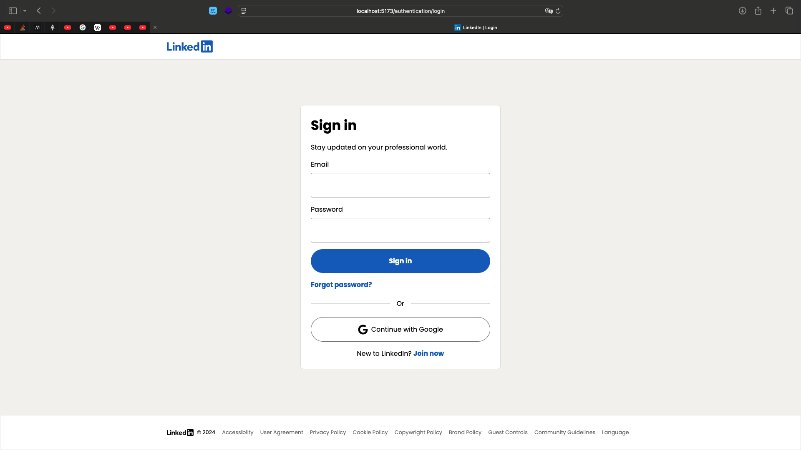
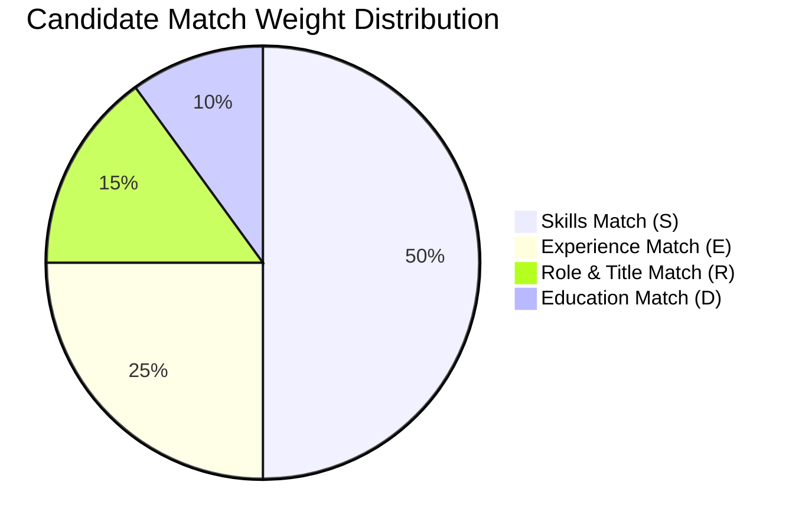
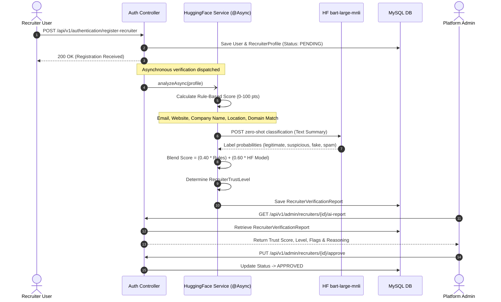

<p align="center">
  
</p>

<h1 align="center">Professional Networking & Recruitment Platform</h1>

<p align="center">
  <strong>An enterprise-grade, full-stack professional networking platform featuring intelligent candidate matching, AI-powered recruiter verification, automated LaTeX resume generation, real-time messaging, community groups, and robust administrative governance.</strong>
</p>

<p align="center">
  
  
  
  
  
  
  
  
  
  
</p>

---

## 📑 Table of Contents

- [Overview](#-overview)
- [System Architecture](#-system-architecture)
- [Key Features](#-key-features)
  - [1. AI Recruiter Fraud & Legitimacy Screening](#1-ai-recruiter-fraud--legitimacy-screening)
  - [2. AI Resume Builder (Gemini AI + LaTeX/PDF)](#2-ai-resume-builder-gemini-ai--latexpdf)
  - [3. Job Portal & Applicant Tracking System (ATS)](#3-job-portal--applicant-tracking-system-ats)
  - [4. Communities & Professional Groups](#4-communities--professional-groups)
  - [5. Real-Time Messaging & WebSocket Broker](#5-real-time-messaging--websocket-broker)
  - [6. Full-Text Search with Apache Lucene](#6-full-text-search-with-apache-lucene)
  - [7. Feed, Social Posts & Threaded Comments](#7-feed-social-posts--threaded-comments)
  - [8. Professional Profile & Virtual Resume](#8-professional-profile--virtual-resume)
  - [9. Professional Networking & Recommendations](#9-professional-networking--recommendations)
  - [10. Admin Governance & Platform Analytics](#10-admin-governance--platform-analytics)
- [Tech Stack](#-tech-stack)
- [Project Directory Structure](#-project-directory-structure)
- [Prerequisites](#-prerequisites)
- [Getting Started & Local Setup](#-getting-started--local-setup)
  - [1. Clone Repository](#1-clone-repository)
  - [2. Start Infrastructure Services (Docker)](#2-start-infrastructure-services-docker)
  - [3. Backend Setup (Spring Boot)](#3-backend-setup-spring-boot)
  - [4. Frontend Setup (React + Vite)](#4-frontend-setup-react--vite)
- [Port Mapping & Service Endpoints](#-port-mapping--service-endpoints)
- [Environment Configuration](#-environment-configuration)
  - [Backend Properties](#backend-properties)
  - [Frontend Environment](#frontend-environment)
- [Deep-Dive: Candidate-Job Matching Formula](#-deep-dive-candidate-job-matching-formula)
- [Deep-Dive: AI Recruiter Verification Pipeline](#-deep-dive-ai-recruiter-verification-pipeline)
- [REST API Reference](#-rest-api-reference)
- [Real-Time WebSocket Protocol](#-real-time-websocket-protocol)
- [Testing & CI/CD](#-testing--cicd)

---

## 🌟 Overview

The **Professional Networking & Recruitment Platform** is a distributed, full-stack LinkedIn-scale web application designed for modern professionals, recruiters, and platform administrators. Built on **Spring Boot 3 (Java 21)** and **React 18 (TypeScript + Vite)**, it pairs high-performance enterprise architecture with cutting-edge artificial intelligence to revolutionize hiring, networking, and career management.

Unlike standard social clones, this system integrates:
1. **Multi-Model AI Pipelines**: Employs **Hugging Face** zero-shot classification for recruiter legitimacy verification and **Google Gemini** for automated LaTeX resume compilation.
2. **Proprietary Multi-Dimensional Candidate Matcher**: Mathematically scores candidate fit against job requirements across skills, chronological experience, title semantics, and education.
3. **High-Performance Search Index**: Leverages **Hibernate Search 7** backed by an **Apache Lucene** inverted index for typo-tolerant fuzzy matching across users and profiles.
4. **Real-Time Communication**: Uses Spring WebSocket with a STOMP message broker for instantaneous 1-on-1 messaging and dynamic notifications.
5. **Role-Based Enterprise Governance**: Provides comprehensive audit workflows for administrators to review AI recruiter trust scores, manage users, and moderate content.

---

## 🏗️ System Architecture

```mermaid
graph TD
    subgraph ClientLayer["Frontend Layer (React 18 + TypeScript + Vite)"]
        UI["React SPA (Port 5173)"]
        Router["React Router v6"]
        StompClient["@stomp/stompjs Client"]
        AuthContext["Auth Context & JWT Store"]
    end

    subgraph ApiGateway["Backend Application (Spring Boot 3.3.4, Java 21 - Port 8081)"]
        SecFilter["Spring Security Filter Chain & JWT Validation"]
        WSBroker["Spring WebSocket STOMP Broker (/ws)"]
        
        subgraph FeatureModules["Domain Feature Modules"]
            AuthMod["Authentication & OAuth2 / OIDC"]
            FeedMod["Social Feed, Likes & Comments"]
            NetMod["Networking & Suggestions"]
            MsgMod["Messaging Engine"]
            GroupMod["Groups & Member Moderation"]
            JobMod["Job Portal & Native ATS Matcher"]
            RecruitMod["Recruiter Verification Engine"]
            ResumeMod["AI Resume Builder Pipeline"]
            SearchMod["Search Engine (Hibernate Search)"]
            AdminMod["Admin Governance Dashboard"]
            StorageMod["File Streaming Storage (/uploads)"]
        end
    end

    subgraph DataAndSearch["Data & Search Infrastructure"]
        MySQL[("MySQL 9.1 Database (Port 3307:3306)")]
        Lucene[("Apache Lucene Inverted Index (./lucene/indexes)")]
        FileStore[("Local Disk File Storage (./uploads)")]
    end

    subgraph ExternalServices["External APIs & Mock Services"]
        MailHog["MailHog SMTP & UI (Ports 1025 / 8025)"]
        GoogleOAuth["Google Identity Services (OAuth 2.0 / OIDC)"]
        HuggingFace["Hugging Face API (facebook/bart-large-mnli)"]
        GeminiAI["Google Gemini AI API (gemini-3.5-flash-lite)"]
        PdfEngine["Local pdflatex / LibrePDF OpenPDF"]
    end

    %% Client communication
    UI -->|REST API over HTTP/JSON| SecFilter
    StompClient -->|WebSocket / STOMP| WSBroker
    AuthContext -->|Token Auth| SecFilter

    %% Security to modules
    SecFilter --> FeatureModules
    WSBroker --> MsgMod

    %% Feature module dependencies
    AuthMod -->|SMTP Verification| MailHog
    AuthMod -->|OIDC Validation| GoogleOAuth
    RecruitMod -->|Zero-shot Classification| HuggingFace
    ResumeMod -->|LaTeX Prompting| GeminiAI
    ResumeMod -->|PDF Compilation| PdfEngine
    SearchMod -->|Read/Write Index| Lucene
    FeatureModules -->|JPA / Hibernate ORM| MySQL
    StorageMod -->|Stream Media & Resumes| FileStore
```



---

## ⚡ Key Features

### 1. AI Recruiter Fraud & Legitimacy Screening
Recruiter accounts undergo automated fraud and legitimacy screening to safeguard job seekers against ghost jobs, spam, and corporate spoofing:
- **Dual-Layer Evaluation**:
  - **Hugging Face Zero-Shot NLP (60% weight)**: Passes corporate registration details to `facebook/bart-large-mnli` to evaluate labels: `legitimate company`, `suspicious profile`, `fake company`, `spam registration`.
  - **Algorithmic Rule Engine (40% weight)**: Audits company email domains (penalizing public providers like Gmail/Yahoo), website security (HTTPS, IP-address detection, suspicious TLDs such as `.xyz`, `.tk`, `.click`), company name semantics, and cross-domain consistency between email and website URLs.
- **Asynchronous Execution (`@Async`)**: Analysis runs in the background upon signup without stalling the recruiter onboarding flow.
- **Admin Verification Dashboard**: Generates an audit report featuring a **Trust Score (0–100)**, **Trust Level badge** (`LEGITIMATE`, `SUSPICIOUS`, `LIKELY_FAKE`, `HIGH_RISK`), per-dimension scores, actionable flags, and automated recommendations for admin approval or rejection.

### 2. AI Resume Builder (Gemini AI + LaTeX/PDF)
Allows users to turn their profile into an industry-grade, ATS-ready resume in seconds:
- **Virtual Resume Generation**: Pulls structured education, experience chronology, projects, and skills from the user profile.
- **Google Gemini AI Transformation**: Prompts `gemini-3.5-flash-lite` (or `gemini-2.0-flash`) with dynamic profile data to synthesize an elegant, Overleaf-grade LaTeX resume document.
- **Dual-Engine PDF Compilation**:
  - **Native `pdflatex`**: Compiles LaTeX locally when TeX Live / MiKTeX is present, matching Overleaf typography.
  - **Zero-Setup Fallback (`LibrePDF / OpenPDF`)**: Automatically compiles a clean PDF if `pdflatex` is not installed on the host system.
- **Flexible Downloads**: Provides one-click downloads for both compiled `.pdf` and raw `.tex` source code.
- **Rate-Limiting Protection**: Enforces an in-memory 2-minute cooldown per user to prevent API abuse.

### 3. Job Portal & Applicant Tracking System (ATS)
Complete recruitment marketplace with intelligent matching for recruiters and candidates:
- **Job Lifecycle**: Recruiters can draft, publish, update, and close job postings specifying title, company, description, work mode (`ON_SITE`, `REMOTE`, `HYBRID`), employment type (`FULL_TIME`, `PART_TIME`, `CONTRACT`, `INTERNSHIP`), minimum experience, and required skills.
- **Candidate Applications**: Applicants submit applications with PDF/document resume uploads.
- **Application Status Tracking**: Recruiter and applicant status sync (`PENDING`, `REVIEWED`, `ACCEPTED`, `REJECTED`).
- **Native ATS Matcher Engine**:
  - **Top Applicant Ranking**: Ranks all candidate resumes for a given posting and highlights the **Top 3 Best-Matching Applicants**.
  - **Personalized Job Recommendations**: Suggests matching open positions to candidates with customizable match score thresholds.

### 4. Communities & Professional Groups
Interactive group networking spaces:
- **Public & Private Communities**: Create open or private groups with custom cover graphics and descriptions.
- **Access Control & Member Moderation**: Admins review pending join requests, promote members to admin, or ban/unban problematic users.
- **Group Feed & Discussions**: Dedicated group timeline supporting rich posts, image uploads, likes, and threaded comments.

### 5. Real-Time Messaging & WebSocket Broker
Instant 1-on-1 private messaging powered by **Spring WebSocket** and **STOMP**:
- Real-time conversation synchronization without polling.
- Conversation threads with unread indicators and read receipt updates (`markMessageAsRead`).
- Clean separation between HTTP REST history retrieval and real-time WebSocket socket events (`/ws`, `/topic/messages`).

### 6. Full-Text Search with Apache Lucene
High-speed professional search powered by **Hibernate Search 7.2.2**:
- Inverted Lucene index (`./lucene/indexes`) updated on database mutations.
- Multi-field search across `firstName`, `lastName`, `position`, and `company`.
- **Levenshtein Fuzzy Matching (distance 2)** to handle typos, misspellings, and partial names.

### 7. Feed, Social Posts & Threaded Comments
- Interactive timeline supporting text and image attachments.
- Full post CRUD operations with author permission checks.
- Like toggle with real-time liker user list modals.
- Multi-level comment conversations with editing and deletion support.

### 8. Professional Profile & Virtual Resume
- Custom profile information: headline, company, position, geographic location, and about section.
- Profile photo and cover photo uploads with immediate image preview.
- Dynamic profile sections:
  - **Work Experience**: Job title, company, dates, description, and automatic experience duration calculation.
  - **Education**: Degree, institution, field of study, and academic dates.
  - **Projects**: Portfolio items with descriptions and external links.
  - **Skills**: Individual skill tags utilized directly by the ATS matcher engine.

### 9. Professional Networking & Recommendations
- Bidirectional connection invitations (`PENDING`, `ACCEPTED`).
- Friend suggestion engine providing smart connection recommendations based on network discovery.
- View connections, accept incoming invitations, or cancel/withdraw sent invitations.

### 10. Admin Governance & Platform Analytics
Centralized admin console available to users with `ROLE_ADMIN`:
- **Platform Analytics**: Total users, active recruiters, pending recruiter reviews, total job postings, total posts, and blocked accounts.
- **Recruiter Review Queue**: Inspect corporate data, read AI audit summaries, and approve or reject recruiter accounts.
- **User Moderation**: Filter users by role and status; block or unblock accounts immediately.
- **Content Moderation**: Administratively remove non-compliant posts and delete malicious job listings with audit reason tracking.

---

## 🛠️ Tech Stack

### Backend
| Technology | Version | Purpose |
| :--- | :--- | :--- |
| **Java** | 21 (LTS) | Core programming language runtime |
| **Spring Boot** | 3.3.4 | Application framework & dependency injection |
| **Spring Security** | 6.x | Authentication, authorization & filter chain |
| **JJWT (io.jsonwebtoken)** | 0.12.6 | JWT token signing, parsing & Bearer auth |
| **Spring Data JPA / Hibernate** | 6.x | ORM, persistence, relational entity mapping |
| **MySQL Connector** | 8.0.33 | Relational database driver |
| **Hibernate Search (ORM)** | 7.2.2.Final | Full-text entity indexing |
| **Hibernate Search (Lucene)** | 7.2.2.Final | Apache Lucene search backend engine |
| **Spring WebSocket / STOMP** | 3.3.4 | Real-time bi-directional messaging broker |
| **Spring Boot Starter Mail** | 3.3.4 | SMTP email dispatch for verification & password reset |
| **LibrePDF OpenPDF** | 1.3.43 | In-memory PDF document generation fallback |
| **Gradle (Kotlin DSL)** | 8.x wrapper | Build automation & dependency management |

### Frontend
| Technology | Version | Purpose |
| :--- | :--- | :--- |
| **React** | 18.3.1 | Declarative UI component library |
| **TypeScript** | 5.5.3 | Static type safety and data modeling |
| **Vite** | 5.4.8 | Lightning-fast development server & bundler |
| **React Router DOM** | 6.27.0 | Client-side routing & protected route layouts |
| **@stomp/stompjs** | 7.0.0 | STOMP client over WebSocket |
| **Sass (SCSS)** | 1.80.3 | Modular component styling with CSS modules |
| **ESLint & Stylelint** | 9.x / 16.x | Code quality, consistency & SCSS linting |

### Infrastructure & External Services
| Component | Details |
| :--- | :--- |
| **MySQL Database** | Official `mysql:9.1.0` Docker image (host port `3307`) |
| **MailHog** | `mailhog/mailhog:v1.0.1` SMTP server (port `1025`) & Web UI (port `8025`) |
| **Google Gemini API** | `gemini-3.5-flash-lite` / `gemini-2.0-flash` for AI LaTeX resume drafting |
| **Hugging Face API** | `facebook/bart-large-mnli` zero-shot classification for recruiter verification |
| **Google OAuth 2.0 / OIDC** | Secure Google Single Sign-On |
| **GitHub Actions** | Automated CI pipeline with path-filtering for frontend & backend |

---

## 📁 Project Directory Structure

```plaintext
professionalNetworkingPlatform/
├── .github/
│   └── workflows/
│       ├── ci.yml                 # Master CI pipeline with path filtering
│       ├── backend.yml            # Backend build, test, and MySQL service workflow
│       └── frontend.yml           # Frontend build, ESLint, and Stylelint workflow
├── backend/
│   ├── docker-compose.yml         # MySQL 9.1 + MailHog service definitions
│   ├── build.gradle.kts           # Gradle build script with Java 21 toolchain
│   ├── settings.gradle.kts        # Gradle project settings
│   ├── gradlew / gradlew.bat      # Gradle wrapper binaries
│   └── src/
│       ├── main/
│       │   ├── java/com/linkedin/backend/
│       │   │   ├── BackendApplication.java
│       │   │   ├── configuration/   # Global MVC & CORS configurations
│       │   │   ├── controller/      # Health & root endpoints
│       │   │   ├── dto/             # Shared response models
│       │   │   └── features/        # Domain-driven modular packages
│       │   │       ├── admin/           # Stats, moderation & review endpoints
│       │   │       ├── authentication/  # JWT, OAuth2, User entities, Security filters
│       │   │       ├── feed/            # Posts, comments, likes & feed service
│       │   │       ├── groups/          # Groups, memberships, roles & group posts
│       │   │       ├── jobs/            # Job postings, ATS, NativeJobMatcherService
│       │   │       ├── messaging/       # Conversations, messages & chat service
│       │   │       ├── networking/      # Connections & friend recommendation algorithm
│       │   │       ├── notifications/   # Real-time event notifications
│       │   │       ├── profile/         # Education, experience, projects, skills
│       │   │       ├── recruiter/       # AI recruiter verification & Hugging Face service
│       │   │       ├── resume/          # Gemini AI resume builder & PDF/LaTeX compiler
│       │   │       ├── search/          # Hibernate Search + Lucene indexer
│       │   │       ├── storage/         # Local file streaming & upload controller
│       │   │       └── ws/              # WebSocket STOMP broker configuration
│       │   └── resources/
│       │       └── application.properties # Main application properties
│       └── test/                    # Unit & integration test suites
├── frontend/
│   ├── index.html                 # Single page application entry HTML
│   ├── package.json               # Frontend dependencies & npm scripts
│   ├── vite.config.ts             # Vite build configuration with matcher proxy
│   ├── tsconfig.json              # TypeScript compiler configuration
│   ├── .env.example               # Template environment variables
│   ├── .env                       # Local environment variables
│   └── src/
│       ├── main.tsx               # Root application entry & router table
│       ├── index.scss             # Global design tokens and reset styles
│       ├── components/            # Reusable shared UI widgets (Buttons, Modals, Inputs)
│       ├── hooks/                 # Custom React hooks (e.g., usePageTitle)
│       ├── utils/                 # HTTP client wrapper (request) with token handling
│       └── features/              # Feature modules matching backend domains
│           ├── admin/             # Analytics, recruiter review, and user management
│           ├── authentication/    # Login, signup, password reset, email verification
│           ├── feed/              # Social post feed, post page, notifications
│           ├── groups/            # Group list, group details, group creation
│           ├── jobs/              # Jobs feed, post job, ATS applicants view
│           ├── messaging/         # Chat conversations and active messaging window
│           ├── networking/        # Connections and invitations manager
│           ├── profile/           # User profile, experiences, projects, skills
│           ├── resume/            # AI Resume Builder interactive page
│           └── ws/                # WebSocket context provider
├── lucene/
│   └── indexes/                   # Apache Lucene indexed directory files
├── uploads/                       # Storage destination for uploaded images & resumes
└── screenshot.png                 # Platform UI overview screenshot
```

---

## 📋 Prerequisites

Ensure the following tools are installed on your host machine:

- **Node.js**: Version `22.x` (or compatible LTS)
- **npm**: Version `10.x` or higher
- **Java JDK**: Version `21` (Eclipse Temurin, OpenJDK, or Amazon Corretto)
- **Docker & Docker Compose**: Docker Engine `24.0.7+` and Docker Compose `v2+`
- *(Optional)* **LaTeX (`pdflatex`)**: Required only if you want native local Overleaf-identical PDF compilation (e.g. TeX Live on Linux/Mac, MiKTeX on Windows). If not installed, the platform automatically falls back to LibrePDF/OpenPDF.
- *(Optional)* **`act`**: For running GitHub Actions workflows locally.

---

## 🚀 Getting Started & Local Setup

### 1. Clone Repository
```bash
git clone https://github.com/your-username/professionalNetworkingPlatform.git
cd professionalNetworkingPlatform
```

---

### 2. Start Infrastructure Services (Docker)
Start the MySQL database and MailHog SMTP server in the background:

```bash
cd backend
docker-compose up -d
```

Verify that the containers are healthy:
```bash
docker ps
```
- **MySQL 9.1**: Running on port `3307` (mapped from container `3306`).
- **MailHog SMTP**: Running on port `1025` (SMTP port for Spring Boot).
- **MailHog Web UI**: Running at [http://localhost:8025](http://localhost:8025) (to view outgoing emails).

---

### 3. Backend Setup (Spring Boot)

From the `backend` directory:

#### Step 3.1: Configure Environment Variables *(Optional)*
If you wish to test Google OAuth 2.0 / OIDC login:

- **Mac / Linux:**
  ```bash
  export OAUTH_GOOGLE_CLIENT_ID=your_google_client_id
  export OAUTH_GOOGLE_CLIENT_SECRET=your_google_client_secret
  ```
- **Windows (PowerShell):**
  ```powershell
  $env:OAUTH_GOOGLE_CLIENT_ID="your_google_client_id"
  $env:OAUTH_GOOGLE_CLIENT_SECRET="your_google_client_secret"
  ```
- **Windows (Command Prompt):**
  ```cmd
  set OAUTH_GOOGLE_CLIENT_ID=your_google_client_id
  set OAUTH_GOOGLE_CLIENT_SECRET=your_google_client_secret
  ```

> [!TIP]
> Google OAuth is completely optional. If left unset, standard email/password registration and login will work seamlessly.

#### Step 3.2: Verify API Keys
In `backend/src/main/resources/application.properties`, verify the AI configuration:
- `huggingface.api.token`: Your Hugging Face token (used for zero-shot recruiter verification).
- `gemini.api.key`: Your Google Gemini API key (free tier available at [Google AI Studio](https://aistudio.google.com/apikey)).

#### Step 3.3: Build & Launch Backend

- **Mac / Linux:**
  ```bash
  ./gradlew bootRun
  ```
- **Windows:**
  ```powershell
  .\gradlew.bat bootRun
  ```

The Spring Boot backend will start on **`http://localhost:8081`**. On first boot, Hibernate will create all database tables and build the initial Lucene search index.

---

### 4. Frontend Setup (React + Vite)

Open a new terminal window and navigate to the `frontend` directory:

```bash
cd frontend
```

#### Step 4.1: Setup Environment File
Copy the example environment file:
- **Mac / Linux:**
  ```bash
  cp .env.example .env
  ```
- **Windows:**
  ```powershell
  copy .env.example .env
  ```

Ensure `.env` matches your backend port:
```env
VITE_API_URL=http://localhost:8081
VITE_GOOGLE_OAUTH_CLIENT_ID=your-google-oauth-client-id
VITE_GOOGLE_OAUTH_URL=https://accounts.google.com/o/oauth2/v2/auth
```

#### Step 4.2: Install Dependencies & Run
```bash
npm install
npm run dev
```

The application UI is now accessible at **`http://localhost:5173`**.

---

## 🌐 Port Mapping & Service Endpoints

| Service | Address | Description |
| :--- | :--- | :--- |
| **Frontend Application** | [http://localhost:5173](http://localhost:5173) | React Single Page Application (Vite) |
| **Backend REST API** | [http://localhost:8081](http://localhost:8081) | Spring Boot REST API server |
| **WebSocket Broker** | `ws://localhost:8081/ws` | Real-time STOMP messaging endpoint |
| **MailHog Web UI** | [http://localhost:8025](http://localhost:8025) | Webmail client to view verification emails |
| **MailHog SMTP** | `localhost:1025` | Mock SMTP server used by Spring Boot |
| **MySQL Database** | `localhost:3307` | Relational database (user: `root`, password: `root`) |

---

## ⚙️ Environment Configuration

### Backend Properties (`backend/src/main/resources/application.properties`)

```properties
# Server
server.port=8081
spring.application.name=backend

# Database
spring.datasource.url=jdbc:mysql://localhost:3307/linkedin?createDatabaseIfNotExist=true
spring.datasource.username=root
spring.datasource.password=root
spring.jpa.hibernate.ddl-auto=update

# Security & JWT
jwt.secret.key=8dc2d2829a1bc4e11a57ca66da09c0cdb547c4e03d6108c629160e50d536bfe2

# MailHog SMTP
spring.mail.host=localhost
spring.mail.port=1025
spring.mail.username=noreply@linkedin.com

# Apache Lucene Search Indexes
spring.jpa.properties.hibernate.search.backend.type=lucene
spring.jpa.properties.hibernate.search.backend.directory.root=./lucene/indexes

# AI Recruiter Verification (Hugging Face)
huggingface.api.token=your_huggingface_token
huggingface.api.url=https://router.huggingface.co/hf-inference/models/facebook/bart-large-mnli
recruiter.ai.verification.enabled=true

# AI Resume Builder (Google Gemini)
gemini.api.key=your_gemini_api_key
gemini.model.name=gemini-3.5-flash-lite
gemini.resume.enabled=true
```

### Frontend Environment (`frontend/.env`)

```env
VITE_API_URL=http://localhost:8081
VITE_GOOGLE_OAUTH_CLIENT_ID=your-google-oauth-client-id
VITE_GOOGLE_OAUTH_URL=https://accounts.google.com/o/oauth2/v2/auth
```

---

## 🎯 Deep-Dive: Candidate-Job Matching Formula

The platform features an algorithmic applicant matching engine (`NativeJobMatcherService`) that computes a composite score $\text{Score} \in [0.0, 1.0]$ between candidate profile attributes and job requirements:

$$\text{Composite Match Score} = (0.50 \times S) + (0.25 \times E) + (0.15 \times R) + (0.10 \times D)$$



### Dimension Details:
1. **Skills Match ($S$, 50% Weight)**:
   - Calculates the ratio of matched skills against required skills: $S = \frac{|\text{Matched}|}{|\text{Required}|}$.
   - Evaluates skills using normalized exact matching and fuzzy containment ($A \subseteq B$ or $B \subseteq A$).
   - If a candidate matches $\ge 80\%$ of required skills, a safety clamp guarantees the composite score does not drop below $0.80$.
2. **Experience Match ($E$, 25% Weight)**:
   - Aggregates chronological days across all experience entries: $\text{Total Years} = \sum \frac{\text{Days}}{365.25}$.
   - If $\text{Total Years} \ge \text{Min Experience}$, then $E = 1.0$.
   - If $\text{Total Years} < \text{Min Experience}$, scaled proportionally: $E = \max\left(0.25, \frac{\text{Total Years}}{\text{Min Experience}}\right)$.
3. **Role & Title Match ($R$, 15% Weight)**:
   - Normalizes the candidate's current headline position against the job title.
   - Evaluates token-level overlap and previous experience title matches ($R \in [0.40, 1.0]$).
4. **Education Match ($D$, 10% Weight)**:
   - Matches required degree keywords (e.g. "Bachelor", "Master", "Computer Science") against candidate degrees and fields of study.

---

## 🔍 Deep-Dive: AI Recruiter Verification Pipeline



### Trust Level Classifications:
| Composite Score | Trust Level | Visual Badge | Recommended Admin Action |
| :---: | :---: | :---: | :--- |
| **80 – 100** | `LEGITIMATE` | 🟢 Legitimate | Profile verified; recommended for approval. |
| **50 – 79** | `SUSPICIOUS` | 🟡 Suspicious | Manual audit advised before approving. |
| **25 – 49** | `LIKELY_FAKE` | 🟠 Likely Fake | Multiple red flags detected; high caution advised. |
| **0 – 24** | `HIGH_RISK` | 🔴 High Risk | Fraudulent pattern detected; recommended for rejection. |

---

## 📡 REST API Reference

All protected endpoints require an `Authorization: Bearer <token>` header.

### Authentication & Users (`/api/v1/authentication`)
| Method | Endpoint | Access | Description |
| :--- | :--- | :--- | :--- |
| `POST` | `/login` | Public | Authenticate user and receive JWT token |
| `POST` | `/register` | Public | Register standard professional account |
| `POST` | `/register-recruiter` | Public | Register recruiter account with business credentials |
| `POST` | `/oauth/google/login` | Public | Sign in or register via Google OAuth 2.0 / OIDC |
| `GET` | `/users/me` | Authenticated | Retrieve authenticated user profile |
| `GET` | `/users/{id}` | Authenticated | Retrieve public user profile by ID |
| `PUT` | `/profile/{id}/info` | Authenticated | Update user name, headline, company, location, about |
| `PUT` | `/profile/{id}/profile-picture` | Authenticated | Upload profile avatar (Multipart) |
| `PUT` | `/profile/{id}/cover-picture` | Authenticated | Upload cover photo (Multipart) |
| `GET` | `/send-email-verification-token` | Authenticated | Send verification email token via MailHog |
| `PUT` | `/validate-email-verification-token` | Authenticated | Validate received email token |
| `PUT` | `/send-password-reset-token` | Public | Request password reset token to email |
| `PUT` | `/reset-password` | Public | Reset password using email token |
| `DELETE` | `/delete` | Authenticated | Delete authenticated user account |

### Social Feed (`/api/v1/feed`)
| Method | Endpoint | Access | Description |
| :--- | :--- | :--- | :--- |
| `GET` | `` | Authenticated | Get personalized feed posts |
| `GET` | `/posts` | Authenticated | Get all platform posts |
| `GET` | `/posts/{postId}` | Authenticated | Get post details by ID |
| `POST` | `/posts` | Authenticated | Create post with optional image (Multipart) |
| `PUT` | `/posts/{postId}` | Authenticated | Edit post content and picture |
| `DELETE` | `/posts/{postId}` | Authenticated | Delete author's post |
| `PUT` | `/posts/{postId}/like` | Authenticated | Toggle like on post |
| `GET` | `/posts/{postId}/likes` | Authenticated | List all users who liked a post |
| `GET` | `/posts/{postId}/comments` | Authenticated | Retrieve threaded comments for post |
| `POST` | `/posts/{postId}/comments` | Authenticated | Post comment on a post |
| `PUT` | `/comments/{commentId}` | Authenticated | Edit comment |
| `DELETE` | `/comments/{commentId}` | Authenticated | Delete comment |
| `GET` | `/posts/user/{userId}` | Authenticated | Get all posts authored by specific user |

### Professional Profile Sections (`/api/v1/profile`)
| Method | Endpoint | Access | Description |
| :--- | :--- | :--- | :--- |
| `GET` | `/users/{userId}/skills` | Authenticated | Retrieve user skills list |
| `POST` | `/skills` | Authenticated | Add new skill to profile |
| `PUT` | `/skills/{skillId}` | Authenticated | Update existing skill |
| `DELETE` | `/skills/{skillId}` | Authenticated | Remove skill |
| `GET` | `/users/{userId}/education` | Authenticated | Retrieve user education entries |
| `POST` | `/education` | Authenticated | Add education entry |
| `PUT` | `/education/{id}` | Authenticated | Update education entry |
| `DELETE` | `/education/{id}` | Authenticated | Delete education entry |
| `GET` | `/users/{userId}/experience` | Authenticated | Retrieve work experience entries |
| `POST` | `/experience` | Authenticated | Add experience entry |
| `PUT` | `/experience/{id}` | Authenticated | Update experience entry |
| `DELETE` | `/experience/{id}` | Authenticated | Delete experience entry |
| `GET` | `/users/{userId}/projects` | Authenticated | Retrieve user projects |
| `POST` | `/projects` | Authenticated | Add project entry |
| `PUT` | `/projects/{id}` | Authenticated | Update project entry |
| `DELETE` | `/projects/{id}` | Authenticated | Delete project entry |

### Job Portal & ATS (`/api/v1/jobs`)
| Method | Endpoint | Access | Description |
| :--- | :--- | :--- | :--- |
| `GET` | `` | Authenticated | Search & filter open jobs (`query`, `location`) |
| `GET` | `/{id}` | Authenticated | Get comprehensive job posting details |
| `POST` | `` | Recruiter / Admin | Create new job posting |
| `PUT` | `/{id}` | Recruiter / Admin | Update job posting |
| `PUT` | `/{id}/publish` | Recruiter / Admin | Publish drafted job |
| `PUT` | `/{id}/close` | Recruiter / Admin | Close active job posting |
| `GET` | `/my-jobs` | Recruiter / Admin | List jobs created by authenticated recruiter |
| `POST` | `/{id}/apply` | User | Submit application with resume upload (Multipart) |
| `GET` | `/my-applications` | User | Retrieve authenticated user's job applications |
| `GET` | `/{id}/applicants` | Recruiter / Admin | List all applicants for a specific job |
| `PUT` | `/applications/{appId}/status` | Recruiter / Admin | Update application status (`PENDING`, `REVIEWED`, `ACCEPTED`, `REJECTED`) |
| `GET` | `/{id}/match-applicants` | Recruiter / Admin | Calculate & return **Top 3 matching applicants** |
| `GET` | `/{id}/top-applicant-evaluation` | User | Evaluate candidate fit score for viewing candidate |
| `GET` | `/recommendations` | User | Get personalized job recommendations |

### Communities & Groups (`/api/v1/groups`)
| Method | Endpoint | Access | Description |
| :--- | :--- | :--- | :--- |
| `GET` | `` | Authenticated | Search groups by query |
| `GET` | `/my` | Authenticated | Retrieve groups user belongs to |
| `POST` | `` | Authenticated | Create group (with optional cover image) |
| `GET` | `/{groupId}` | Authenticated | Get group details & membership status |
| `PUT` | `/{groupId}` | Group Admin | Update group privacy (Public/Private) |
| `DELETE` | `/{groupId}` | Group Admin | Delete group |
| `POST` | `/{groupId}/join` | Authenticated | Request to join group |
| `DELETE` | `/{groupId}/leave` | Authenticated | Leave group |
| `GET` | `/{groupId}/members` | Group Admin | Retrieve group members list |
| `PUT` | `/{groupId}/members/{targetId}/accept` | Group Admin | Accept pending join request |
| `DELETE` | `/{groupId}/members/{targetId}/reject` | Group Admin | Reject join request |
| `DELETE` | `/{groupId}/members/{targetId}` | Group Admin | Remove member from group |
| `PUT` | `/{groupId}/members/{targetId}/ban` | Group Admin | Ban member from group |
| `PUT` | `/{groupId}/members/{targetId}/unban` | Group Admin | Unban member |
| `PUT` | `/{groupId}/members/{targetId}/promote` | Group Admin | Promote member to Group Admin |
| `GET` | `/{groupId}/posts` | Group Member | Retrieve group discussions |
| `POST` | `/{groupId}/posts` | Group Member | Create group post with picture (Multipart) |
| `PUT` | `/{groupId}/posts/{postId}/like` | Group Member | Toggle like on group post |
| `GET` | `/{groupId}/posts/{postId}/comments`| Group Member | Get comments for group post |
| `POST` | `/{groupId}/posts/{postId}/comments`| Group Member | Comment on group post |

### AI Resume Builder (`/api/v1/resume`)
| Method | Endpoint | Access | Description |
| :--- | :--- | :--- | :--- |
| `POST` | `/generate` | Authenticated | Trigger Gemini AI to compile profile into LaTeX/PDF |
| `GET` | `/latest` | Authenticated | Fetch URLs for user's most recently compiled resume |

### Networking (`/api/v1/networking`)
| Method | Endpoint | Access | Description |
| :--- | :--- | :--- | :--- |
| `GET` | `/connections` | Authenticated | List connections by status (`PENDING`, `ACCEPTED`) |
| `POST` | `/connections` | Authenticated | Send connection request to recipient |
| `PUT` | `/connections/{id}` | Authenticated | Accept connection request |
| `DELETE` | `/connections/{id}` | Authenticated | Reject, cancel, or remove connection |
| `PUT` | `/connections/{id}/seen` | Authenticated | Mark connection request as seen |
| `GET` | `/suggestions` | Authenticated | Retrieve smart friend suggestions |

### Real-Time Messaging (`/api/v1/messaging`)
| Method | Endpoint | Access | Description |
| :--- | :--- | :--- | :--- |
| `GET` | `/conversations` | Authenticated | Get all active user conversation threads |
| `GET` | `/conversations/{id}` | Authenticated | Get full message history of conversation |
| `POST` | `/conversations` | Authenticated | Start conversation and dispatch initial message |
| `POST` | `/conversations/{id}/messages`| Authenticated | Add message to existing conversation |
| `PUT` | `/conversations/messages/{id}` | Authenticated | Mark message as read |

### Notifications & Search
| Method | Endpoint | Access | Description |
| :--- | :--- | :--- | :--- |
| `GET` | `/api/v1/notifications` | Authenticated | Get authenticated user notifications |
| `PUT` | `/api/v1/notifications/{id}` | Authenticated | Mark notification as read |
| `GET` | `/api/v1/search/users` | Authenticated | Lucene fuzzy search across name/title/company |
| `GET` | `/api/v1/storage/{filename}` | Public | Stream media files, images, PDFs, and .tex files |

### Administrator Console (`/api/v1/admin`)
| Method | Endpoint | Access | Description |
| :--- | :--- | :--- | :--- |
| `GET` | `/stats` | Admin Only | Platform statistics overview |
| `GET` | `/users` | Admin Only | List all registered users (filter by role & status) |
| `PUT` | `/users/{id}/block` | Admin Only | Block user account |
| `PUT` | `/users/{id}/unblock` | Admin Only | Unblock user account |
| `GET` | `/recruiters` | Admin Only | List recruiter verification queue |
| `GET` | `/recruiters/{id}/ai-report` | Admin Only | Fetch Hugging Face AI verification report |
| `PUT` | `/recruiters/{id}/approve` | Admin Only | Approve recruiter account |
| `PUT` | `/recruiters/{id}/reject` | Admin Only | Reject recruiter account |
| `GET` | `/posts` | Admin Only | List all posts across platform |
| `DELETE` | `/posts/{postId}` | Admin Only | Delete inappropriate post |
| `GET` | `/jobs` | Admin Only | List all job postings across platform |
| `DELETE` | `/jobs/{jobId}` | Admin Only | Administratively remove job posting with reason |

---

## ⚡ Real-Time WebSocket Protocol

The application implements a STOMP over WebSocket broker configured in `backend/src/main/java/com/linkedin/backend/features/ws`:

- **Handshake Endpoint**: `ws://localhost:8081/ws`
- **Application Destination Prefix**: `/app`
- **Message Broker Destination**: `/topic`

### Subscription Channels:
- **Conversation Stream**: `/topic/conversations/{conversationId}` — Inbound messages, read status updates.
- **User Notifications**: `/topic/users/{userId}/notifications` — Real-time notification toasts for likes, comments, and connection requests.

---

## 🧪 Testing & CI/CD

### Backend Tests
Run the Spring Boot test suite using Gradle:

```bash
cd backend
./gradlew test
```
*Windows:*
```powershell
cd backend
.\gradlew.bat test
```

Includes unit and integration tests:
- `BackendApplicationTests.java`: Context loading and application boot verification.
- `JobRecommendationServiceTest.java`: Verification of recommendation algorithms and score thresholds.
- `HuggingFaceVerificationServiceTest.java`: Testing of the dual-layer recruiter verification engine.

### Frontend Quality Checks
Run linting and type checks in the `frontend` directory:

```bash
cd frontend
npm run lint         # ESLint TypeScript verification
npm run lint:css     # Stylelint SCSS verification
npm run build        # Production TypeScript compilation & Vite bundle
```

### GitHub Actions Local Simulation (`act`)
To test the CI/CD pipeline locally without pushing commits, use `act`:

1. Create a mock push event file `event.json`:
```json
{
  "repository": {
    "default_branch": "main"
  },
  "push": {
    "base_ref": "refs/heads/main",
    "commits": [
      {
        "modified": ["frontend/src/App.tsx", "backend/src/main/java/com/linkedin/backend/BackendApplication.java"]
      }
    ]
  }
}
```

2. Execute `act`:
```bash
act -e event.json
```

---

## 👥 Roles & Permissions Matrix

| Feature / Resource | Standard User (`ROLE_USER`) | Recruiter (`ROLE_RECRUITER`) | Platform Admin (`ROLE_ADMIN`) |
| :--- | :---: | :---: | :---: |
| Browse Feed & Post Updates | ✅ | ✅ | ✅ |
| Add Likes & Comments | ✅ | ✅ | ✅ |
| Send & Accept Connections | ✅ | ✅ | ✅ |
| Real-Time 1-on-1 Chat | ✅ | ✅ | ✅ |
| Create / Join Groups | ✅ | ✅ | ✅ |
| Generate AI LaTeX Resumes | ✅ | ✅ | ✅ |
| Apply for Jobs | ✅ | ❌ | ❌ |
| Post Job Openings | ❌ | ✅ (Upon Approval) | ✅ |
| Review Job Applicants & Resumes | ❌ | ✅ (Own Jobs) | ✅ (All Jobs) |
| Run Top-Applicant Matcher | ❌ | ✅ (Own Jobs) | ✅ (All Jobs) |
| Access Admin Dashboard & Stats | ❌ | ❌ | ✅ |
| Inspect AI Recruiter Reports | ❌ | ❌ | ✅ |
| Approve / Reject Recruiters | ❌ | ❌ | ✅ |
| Block / Unblock Users | ❌ | ❌ | ✅ |
| Administratively Delete Content | ❌ | ❌ | ✅ |

---

## 📄 License

Distributed under the MIT License. See `LICENSE` for more information.
